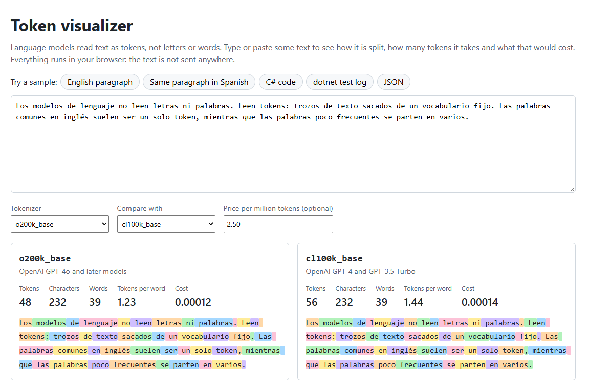

# Token visualizer

[](https://github.com/robmardeveloper/token-visualizer/actions/workflows/ci.yml)

A web page that shows how language models split text into tokens: the pieces they actually read and that you pay for.
Type or paste some text and see each token in its own color, how many there are and what they would cost. It runs
entirely in the browser with Blazor WebAssembly. The text is never sent to a server.

**Try it:** https://robmardeveloper.github.io/token-visualizer/



## What it shows

- **Each token in color.** Hover over one to see its ID in the tokenizer's vocabulary.
- **Two tokenizers side by side:** `o200k_base` (OpenAI GPT-4o and later) and `cl100k_base` (GPT-4 and GPT-3.5 Turbo).
- **Totals:** tokens, characters, words and tokens per word.
- **Cost, if you want it.** Type a price per million tokens and it multiplies. No prices are built in because they
  change too often.
- **One-click samples** chosen to show where counts differ.

## What the samples show

| Sample | Characters | `o200k_base` | `cl100k_base` |
| --- | ---: | ---: | ---: |
| English paragraph | 197 | 39 | 39 |
| The same paragraph in Spanish | 232 | 48 | 56 |
| C# code | 406 | 81 | 71 |
| `dotnet test` log | 654 | 170 | 169 |
| JSON | 244 | 96 | 95 |

- The same meaning costs more outside English: 23% more tokens in Spanish with the newer tokenizer and 44% more with
  the older one.
- A newer tokenizer is not better at everything. On this C# sample the older one uses fewer tokens.
- Logs and JSON are expensive: three to four tokens per word, against just over one for plain English. Worth knowing
  before pasting a long build log into a prompt.

## How it works

The solution has two projects:

- **`TokenVisualizer.Core`**, a plain .NET library with all the logic and its tests. It uses
  [Microsoft.ML.Tokenizers](https://www.nuget.org/packages/Microsoft.ML.Tokenizers), Microsoft's .NET implementation
  of OpenAI's tokenizers, and loads each vocabulary once.
- **`TokenVisualizer.Web`**, the Blazor WebAssembly page. It only shows what Core computes.

Three details that took some thought:

- **Tokens can overlap.** These tokenizers work on bytes, not characters. An emoji or an accented letter can be split
  into several tokens that all point at the same character, so a naive view would show the emoji twice. The analyzer
  joins overlapping tokens into one colored piece, and hovering over it lists every ID (for example, the pizza emoji
  is two tokens with `cl100k_base`). A test checks that the pieces always rebuild the original text exactly.
- **Characters are counted as people count them.** An emoji with a skin tone is four `char` values in .NET but one
  character on screen. The count uses text elements (`StringInfo`), not `string.Length`.
- **Tokenizing only when needed.** Typing a price does not tokenize the text again. Each panel only recomputes when
  the text or the tokenizer changes.

## Download size

Everything the page needs comes down to the browser on the first visit. Measured on the Release build:

- **4.0 MB** compressed with Brotli, 8.9 MB uncompressed.
- **4.5 MB** from GitHub Pages, which hosts the live page. Pages compresses with gzip, not Brotli. On later visits
  the browser can reuse the files from its cache.
- The two vocabularies are 1.6 MB of that (1.2 MB for `o200k_base`, 0.5 MB for `cl100k_base`).
- The culture data (ICU) is left out with `InvariantGlobalization`, which saved about 0.8 MB. The page is in English
  and tokenizing does not depend on the culture.

## Limits

- **Only OpenAI's tokenizers.** Every model family splits text its own way. Claude's tokenizer is not public, so it
  cannot run here. Others, like Llama's, are public but left out to keep the download small. For exact counts on
  those models, use the provider's own tools. Anthropic's API, for example, has an endpoint that counts tokens.
- **Raw text only.** A real chat request also spends tokens on message formatting, the system prompt and tool
  definitions, so its count is higher than the text alone.
- **Words are counted by spaces.** That works for English or Spanish but means little for Chinese or Japanese.

## Run it locally

You need the .NET 10 SDK.

```
dotnet run --project src/TokenVisualizer.Web
dotnet test --solution TokenVisualizer.slnx
```

## Credits

- The idea comes from the lesson
  [Subword tokenization](https://github.com/rohitg00/ai-engineering-from-scratch/tree/main/phases/05-nlp-foundations-to-advanced/19-subword-tokenization)
  of the course [AI Engineering from Scratch](https://github.com/rohitg00/ai-engineering-from-scratch) (MIT licence).
- Tokenizers by [Microsoft.ML.Tokenizers](https://github.com/dotnet/machinelearning) (MIT licence).

## License

[MIT](LICENSE)
